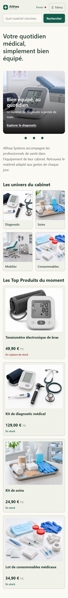
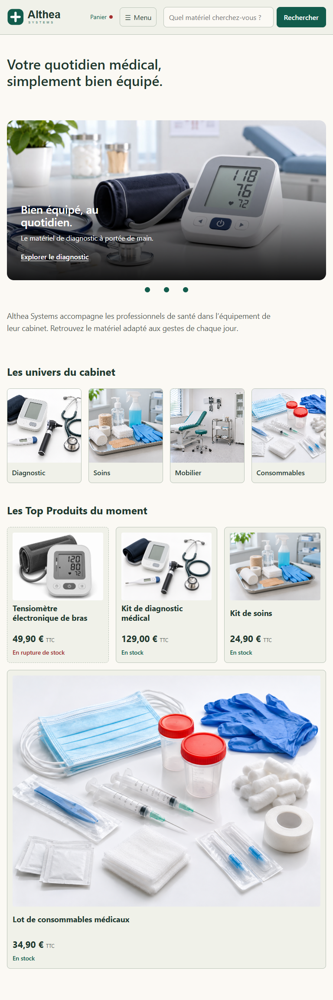
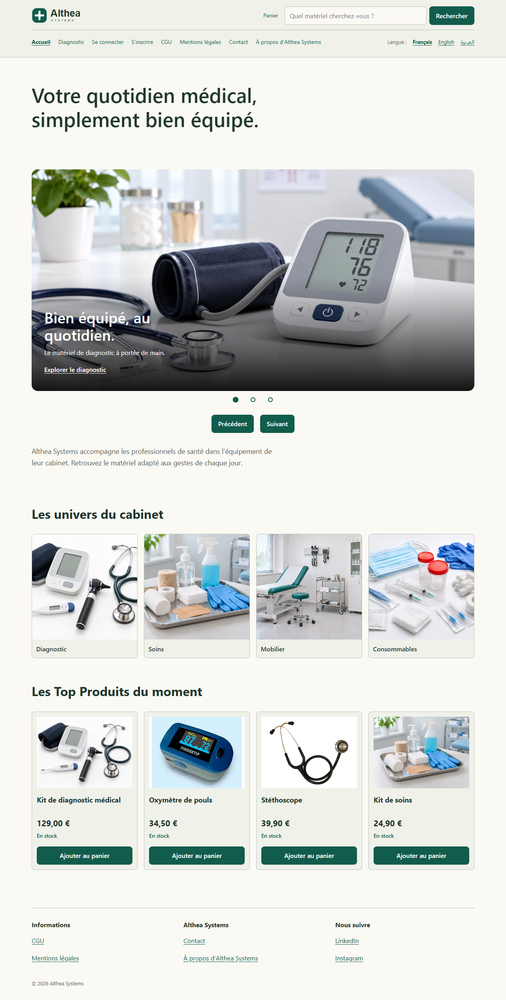
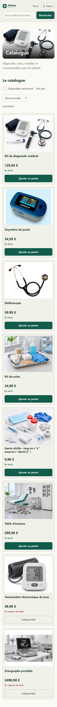
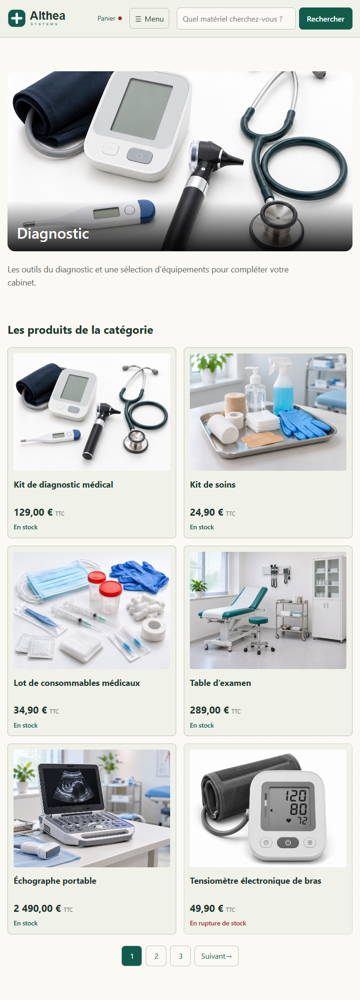
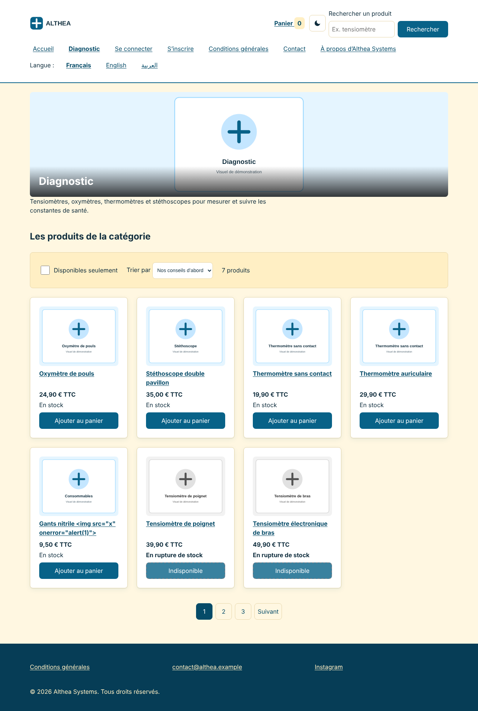
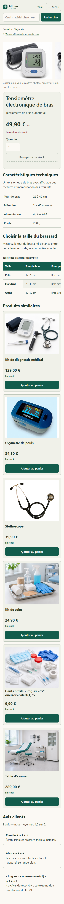
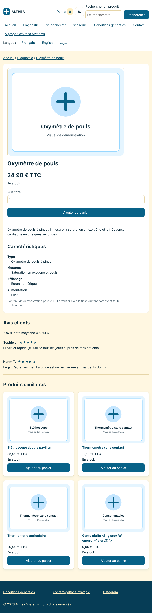
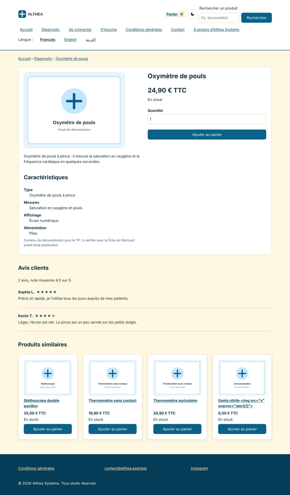
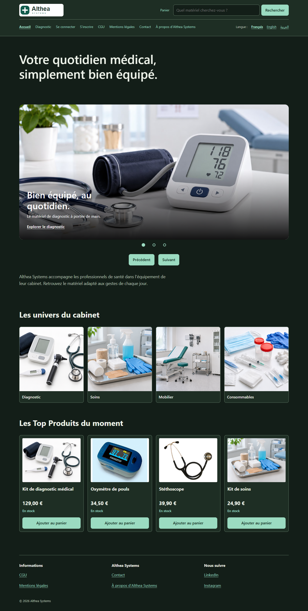

# Althea Systems — TP 1, 2 et 3

Projet de bachelor : un site de matériel médical en HTML, CSS et JavaScript.

## Ouvrir le projet

Lancer `index.html` avec Live Server dans VS Code. Un serveur local est nécessaire pour les modules JavaScript et le chargement des avis.

## Travail réalisé

- Jour 1 : accueil et fiche produit en HTML et CSS.
- Jour 2 : pages catégorie, recherche, connexion et inscription, responsive, mode sombre et impression.
- Jour 3 : catalogue dynamique, recherche, menu, carrousel, avis et panier sauvegardé.

## Arborescence

```text
althea-front/
  index.html
  categorie.html
  produit.html
  recherche.html
  panier.html
  connexion.html
  inscription.html
  css/variables.css
  css/style.css
  js/                  Modules décrits ci-dessous
  data/avis.json       Avis des produits
  img/                 Images du site
  docs/                Analyse, tests, sécurité et captures
```

Flexbox sert à aligner les éléments du menu et les cartes. Grid organise les grilles de produits et la fiche sur ordinateur. Les styles partent du mobile, puis s’adaptent avec des media queries.

## JavaScript

| Fichier dans `js/` | Rôle |
|---|---|
| produits.js | Données du catalogue et recherche par identifiant |
| tri.js | Tris et contrôle du choix de tri |
| outils.js | Prix au format français |
| catalogue.js | Création des cartes et ajouts depuis les listes |
| panier.js | Articles, quantités, total et stockage |
| icone-panier.js | Compteur et point du panier |
| menu.js | Ouverture, fermeture et touche Échap |
| carrousel.js | Boutons et pastille active |
| fiche.js | Produit affiché et vérification de la quantité |
| avis.js | Chargement et affichage des avis |
| recherche.js | Recherche sans accent et filtres |
| vue-panier.js | Lignes du panier, quantités et suppression |
| tests.js | Dix tests lancés avec `categorie.html?tests` |
| main.js | Initialisation des fonctions selon la page |

Le tri recommandé met les prioritaires en premier, les autres ensuite et les épuisés à la fin. Les tris par prix gardent aussi les épuisés à la fin.

Les données sont affichées avec `textContent`. Le panier garde seulement les identifiants et les quantités dans le navigateur, puis les vérifie à la relecture. Les comptes ne sont pas reliés à un serveur.

## Documents et tests

- [Analyse](docs/analyse.md) : organisation des pages.
- [Responsive](docs/responsive.md) : mise en page et captures.
- [Sécurité](docs/securite.md) : protections et tests XSS.
- [Audit](docs/audit.md) : contrôles HTML, CSS et accessibilité.
- [Tests JavaScript](docs/tests-js.md) : dix tests des fonctions et parcours dans le navigateur.

Les dix tests des fonctions et les tests interactifs passent. Les sept pages ont été contrôlées à 320, 360, 768 et 1 280 px, en clair et en sombre. Lighthouse Accessibilité donne 100/100 sur les sept pages au contrôle du 4 novembre 2026. Les validations officielles W3C et les vérifications manuelles restantes sont précisées dans les documents.

## Captures

Les cartes passent en grille sur grand écran. La galerie et le tableau défilent dans leur propre zone pour éviter les débordements sur téléphone.

| Page | 360 px | 768 px | 1 280 px |
|---|---|---|---|
| Accueil |  |  |  |
| Catégorie |  |  |  |
| Produit |  |  |  |



## Photos ajoutées

- `img/oxymetre-photo.jpg` : [photo de Thinkpaul](https://commons.wikimedia.org/wiki/File:FingertipPulseOximeter300C2.jpg), version de Wdwd, [CC BY-SA 3.0](https://creativecommons.org/licenses/by-sa/3.0/). Version réduite fournie par Wikimedia, sans autre retouche.
- `img/stethoscope-photo.png` : [photo de Huji, version de Sonarpulse](https://commons.wikimedia.org/wiki/File:Stethoscope-2.png), domaine public, fichier repris sans retouche.
