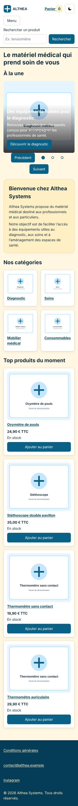
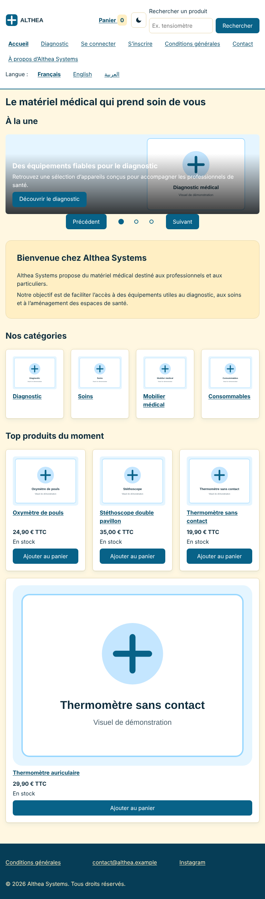
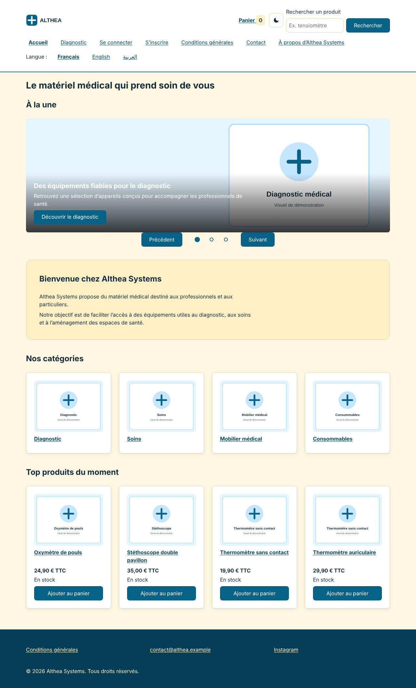

# Althea Systems — TP Jour 2 et 3

Site vitrine de démonstration (matériel médical) : accueil, catégorie, produit, recherche, panier, connexion, inscription et conditions générales. HTML, CSS et JavaScript (modules ES6), sans bibliothèque.

## Ouvrir le site

**Avec un serveur** : dans VS Code, clic droit sur `index.html` → « Open with Live Server » (ou `python -m http.server` dans le dossier, puis http://localhost:8000). Les modules JavaScript sont bloqués si on ouvre le fichier par double clic : le catalogue reste vide et les boutons du carrousel ne font rien. Un bandeau rouge le signale alors.

## Arborescence

```text
althea-front/
├── index.html  categorie.html  produit.html  recherche.html  panier.html
├── connexion.html  inscription.html  cgu.html
├── css/   variables.css (couleurs, tailles, mode sombre)   style.css
├── js/    (voir le tableau ci-dessous)
├── data/  avis.json
├── img/   (SVG de démonstration, tensiometre-face-400.jpg / -800.jpg)
├── docs/  analyse.md  audit.md  responsive.md  securite.md  tests-js.md  captures/
└── .gitignore  README.md
```

## JavaScript (jour 3)

| Fichier | Rôle |
|---|---|
| `js/main.js` | point d’entrée : branche tous les autres fichiers (chargé en `type="module"`) |
| `js/produits.js` | les données : un objet par produit (dont un produit piège contre le XSS) |
| `js/tri.js` | le tri : prioritaires en tête, épuisés à la fin ; `TRIS`, liste blanche `lireTri` |
| `js/outils.js` | `formaterPrix`, `centimes`, `el` (création d’éléments, texte en `textContent`) |
| `js/catalogue.js` | crée les cartes produit, remplit la liste, un seul écouteur pour tous les boutons « Ajouter au panier » |
| `js/recherche.js` | recherche sans accent, filtres prix et disponibilité, lecture sûre de l’adresse |
| `js/panier.js` | l’état du panier : ajouter, quantité, supprimer, total, sauvegarde dans `localStorage` |
| `js/vue-panier.js` | dessine la page panier à partir de l’état |
| `js/annonce.js` | notification « ajouté au panier » (zone `role="status"`, lue par les lecteurs d’écran) |
| `js/icone-panier.js` | point rouge et nombre d’articles de l’en-tête |
| `js/menu.js` | menu burger (`aria-expanded`, touche Échap) |
| `js/carrousel.js` | boutons Précédent / Suivant, pastille de la slide visible (`IntersectionObserver`) |
| `js/fiche.js` | page produit : lit `?id=` (liste blanche), affiche le produit choisi, achat avec quantité vérifiée, produits similaires |
| `js/avis.js` | avis chargés avec `fetch`, validés, affichés en texte |
| `js/tests.js` | 10 tests, lancés seulement avec `categorie.html?tests` |
| `js/avertissement.js` | bandeau d’aide quand la page est ouverte sans serveur (script classique) |
| `js/theme.js` | bouton de mode sombre (script classique, chargé d’abord pour éviter le flash) |

**La règle du tri** : prioritaires, puis les autres, puis les épuisés ; un produit prioritaire mais épuisé va à la fin. Les tris par prix gardent aussi les épuisés à la fin.

**La règle `textContent`** : une donnée (nom, avis, mot de recherche) s’écrit toujours avec `textContent`, jamais avec `innerHTML`. Détails et tests pièges dans `docs/securite.md`.

## Mode sombre

Il suit le réglage de l’appareil au premier passage ; le bouton ☾ / ☀ de l’en-tête permet de choisir, et le choix est gardé sur toutes les pages (`localStorage`, « light » ou « dark » seulement). Les couleurs sont dans `css/variables.css` ; les contrastes (≥ 4,5:1, clair et sombre) y sont notés. À l’impression, tout repasse en noir sur blanc.

## Couleurs

Palette Color Hunt : `#086288` (primaire), `#4D8DBA` (secondaire, accents), `#97D7FF` (bordures bleues), `#FFEFC4` (crème : panneaux, pied de page, texte du pied). Tout est dans `css/variables.css` : les variables du mode clair, puis celles du mode sombre (mêmes noms, autres valeurs). Le texte a au moins 4,5:1 de contraste partout (les ratios sont notés en commentaire dans le fichier). Les images SVG de démonstration sont recolorées avec la même palette.

## Responsive (jour 2)

Mobile d’abord (`min-width` en rem : 48rem, 64rem). Flexbox pour les lignes, Grid pour les grilles. Le pied de page est visible sur tous les écrans (3 colonnes dès 48rem). Constats et corrections dans `docs/responsive.md`.

| Page | 360 px | 768 px | 1 280 px |
|---|---|---|---|
| Accueil |  |  |  |
| Catégorie |  |  |  |
| Produit |  |  |  |

Accueil en mode sombre (choisi avec le bouton) : 

## Tests

- Contrôle automatique : 81 tests réussis sur 81 (voir `docs/tests-js.md`) ; `categorie.html?tests` affiche « Tests : 10 / 10 réussis ».
- **À lancer et à noter ici :** validateur HTML (validator.w3.org), validateur CSS (jigsaw.w3.org/css-validator), Lighthouse Accessibilité (objectif ≥ 90). Aucun score n’est écrit tant qu’il n’a pas été mesuré.

## À remplacer avant publication

Images SVG et textes de démonstration ; avis de `data/avis.json` (dont deux avis pièges) ; adresse Instagram, pages `en/` et `ar/` du choix de langue, qui n’existent pas encore.
